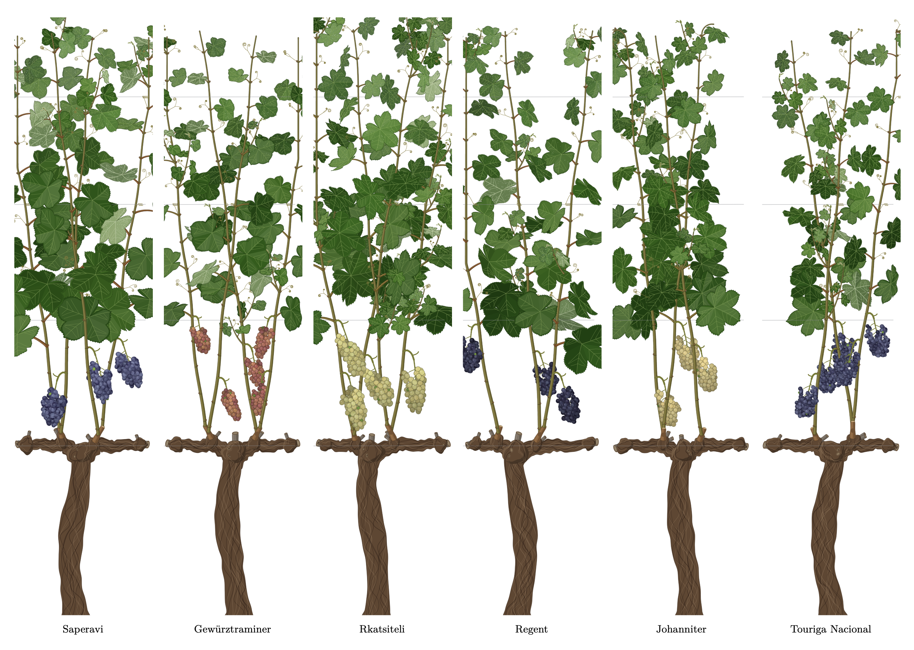
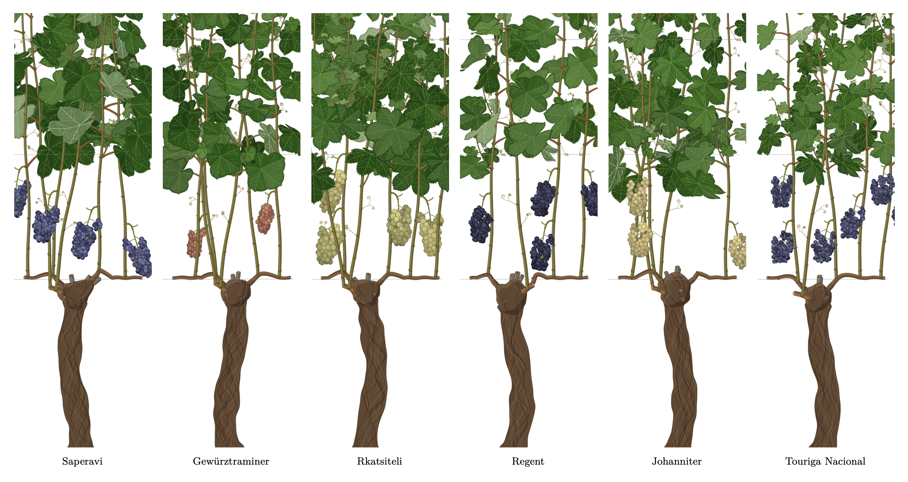
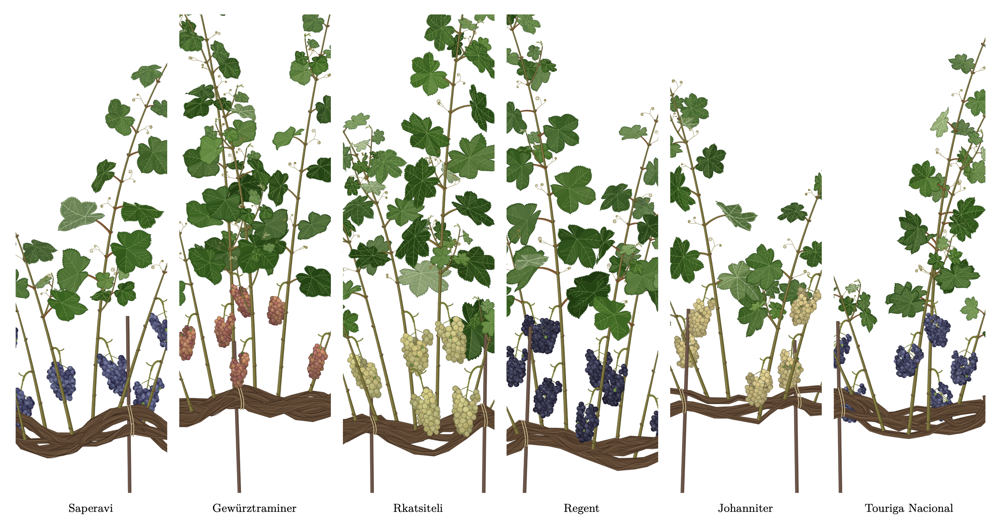
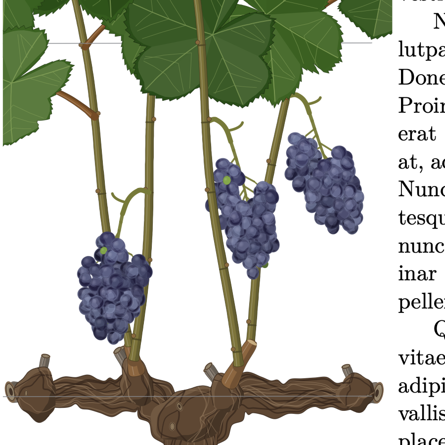
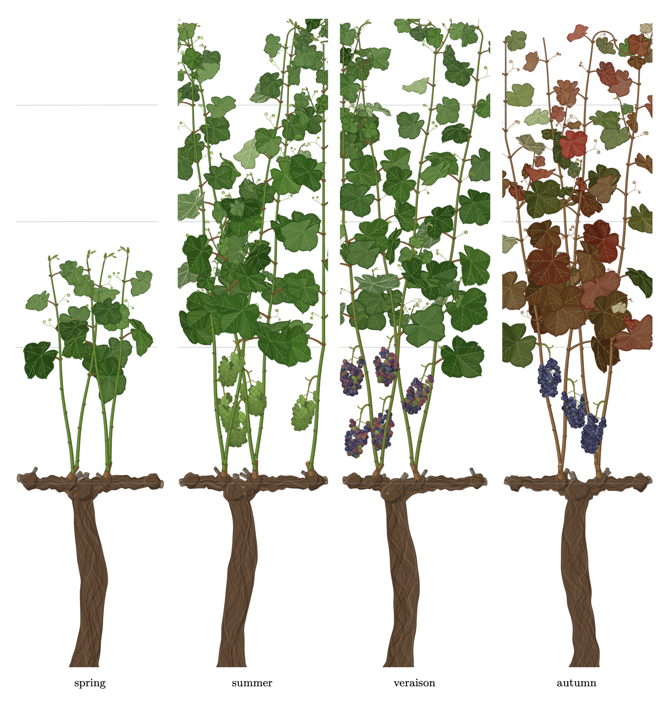

# florilegium, with grapevines

A grapevine that grows in the margin of a page. This is a fork of Kevin Raymond's
[florilegium](https://github.com/kevinraymond/florilegium), the LuaLaTeX package that grows
Delft-blue flowers in the margin of a page. The fork keeps only one plant, and draws it properly:
a grapevine pruned and trained as a vineyard trains it, spur- or cane-pruned up the margin or
braided low across it in Tenerife's trenzado, in eight varieties, through the seasons. None of it is an image
file. Every cane, leaf, tendril and grape is a curve computed while the page is made, so every
page grows a vine of its own.



*Eight varieties at harvest, each the margin of a page of `showcase.tex`.*

[The vine](#the-vine) · [the canes](#the-canes) · [the trenzado](#the-trenzado) · [the bunches](#the-bunches) ·
[the leaves](#the-leaves) · [the seasons](#the-seasons) · [the varieties](#the-varieties) ·
[quick start](#quick-start) · [Kevin's original repository](https://github.com/kevinraymond/florilegium)

## The vine


By default (`pruning=spur`) the vine is laid out as a vineyard's is, spur-pruned on a vertical
shoot positioned trellis, seen from the side of the row, with the margin as its panel:

- **The trunk** rises from the foot of the page to the fruiting wire, a third of the way up, and
  divides into the **cordon**, two barked, knotted arms laid along the wire.
- **Old wood** swells where it has been pruned year after year: at the head of the trunk, at
  each spur position and at each arm's end, where it was stopped. Each knob is lumpy and
  scarred, its bark running into it in strands. The old cuts on its face are ringed with callus
  and sometimes rotted hollow, kept to one side of it, as pruners keep their wounds to one side
  so the sap runs on along the other. The stubs of old spurs and canes stand out of it, dead and
  grey, cut a finger's length above the living wood so that the wood drying out behind the cut
  stays in the stub.
- **Spurs** sit along the cordon, each a stub of last year's cane cut back to two buds, its
  pruning cut showing, rising from its knuckle a little higher than the spurs cut back there
  before it. Each leans its own way, and the two shoots from its buds splay apart.
- **Shoots** grow from the buds, trained straight up between the catch wires, thick at the base,
  their nodes swollen, and hedged level at the top, where some flop over. Each stands a little
  nearer or farther in the canopy than its neighbours, and its bunches hang near its own depth,
  so a bunch hides the shoots behind its own and is hidden by those in front of it.
- At every node, a **leaf** on a long stalk, alternately left and right, with the dormant bud in
  its axil. Opposite the leaf: nothing at the first two nodes, a **bunch** at one or two of the
  third, fourth and fifth, then a forked, coiling **tendril** at two nodes in every three. That
  is how a real shoot carries them. Which nodes fruit is chosen so the bunches spread through
  the fruit zone: a node at the height of a bunch already hanging is unlikely to carry another,
  and bunches that would crowd one another are thinned.
- The **fruit zone** just above the cordon is stripped of its leaves, as growers strip it in
  summer, so the bunches hang clear. Tendrils that reach a catch wire coil round it.

The vine grows in the wider side margin, and in a two-sided document it changes sides with the
page and is drawn mirrored.

## The canes



*The same varieties, cane pruned (`pruning=cane`).*

Cane pruning (the double Guyot) uses the same trellis and the same upright shoots, but keeps no
cordon. Each winter the trunk is cut back to its head, a hand's breadth or two under the
fruiting wire, and left with two of last year's canes and a renewal spur:

- **The head** is a fist of old wood, knobbed and scarred by years of the same cuts, the grey
  stubs of old canes standing out of its top, all to one side. Last year's spurs come out of it,
  each now carrying its cane.
- **The canes**, one each way and a finger thick, leave the head rising, bow over and are bent
  down onto the fruiting wire, then run along it to where they were cut, their nodes swollen
  and their cut ends showing. They are smoother and paler than the trunk's bark: one-year wood.
- **Shoots** grow from nearly every bud along the canes, closer together than a spur vine's,
  and are trained straight up between the catch wires as the spur vine's are.
- **The renewal spur** at the head, two buds, grows the shoots that will be laid down as next
  year's canes when this year's are cut away. They bear no fruit: the grower takes off any
  bunches they set, so they carry tendrils where a fruiting shoot hangs its bunches.

## The trenzado



*The same eight varieties, the same pages, trained as trenzado (`pruning=trenzado`).*

The *cordón trenzado*, the braided cordon, is the old training of the Valle de La Orotava in
Tenerife, found nowhere else. Each year's cane is plaited onto the old ones, so the cordon grows
into a rope of wood that can run for ten metres or more along the slope, lifted off the ground on
props. It is drawn as a stretch of that rope crossing the margin, with no trunk in sight (the
braid begins a metre and a half from it):

- **The braid** is a loose plait of old canes, barked like the spur vine's trunk, each kinked at
  its nodes and wandering over and under the others, with gaps between them. Its looseness is
  set by `BRAID_LOOSENESS` in `florilegium-grapes-vine.lua`: 0 a tight bundle of six to eight
  canes, 1 two to four spread wide (0.6 by default).
- **Thin steel poles** hold it up close to the ground, each lashed to it with two turns of twine;
  between them it sags. (The valley holds its braids 60 to 80 cm up on forked props, once of
  laurel wood and now often of building rebar; the drawing keeps it lower.)
- **Shoots** grow from the nodes of the braid's canes, wherever one faces out, with no wires to
  train them: they rise at a lean of their own and arch over under their weight.
- The bunches hang low over the braid, a narrow band of leaves above it is plucked, and the
  tendrils have nothing to grip.

## The bunches



A bunch is built the way a grape bunch is: a bare stalk from the node, then a main axis with a
spiral of branches off it, longest at the shoulders. Each branch arches down under its weight
and ends in a small cluster of grapes, each grape on its own short stem, hanging under its own
weight. Compact varieties close up into a tight bunch; looser ones show their gaps.

How many grapes a bunch holds, how big they are and how long the bunch is come from vineyard
figures: about 110 grapes of 13 mm on a 13 cm bunch for pinot noir, for example, drawn a little
larger than life, as an illustrator enlarges the fruit.

Each grape carries its **bloom**, the powdery wax on a grape's skin. It is drawn as a powder,
not a film: uneven drifts of it, thicker on some grapes than others, palest at the rim, rubbed
off in places to show the darker skin, with a fine grain on the grapes nearest you. The grapes
ripen one by one through veraison, from green through red to their own colour, and a few stay
small and green.

## The leaves


A leaf is round, cut into three or five lobes as its variety cuts them, with a sinus where the
stalk joins, saw teeth pointing to the lobe tips, five main veins from the stalk and side veins
off them. It is not flat: each blade cups, droops or arches, ripples between its lobes and
twists a little, then is turned and tipped at an angle of its own and lit by how each part
faces the light. A few are turned over to show their paler underside.

The leaves age along the cane. The oldest, low down, are the largest and, late in the season,
duller, browned at the edges and spotted; the young ones near the tips are small and downy,
covered in fine hairs. How hairy depends on the variety: rkatsiteli's leaves are known for their
down, johanniter's are nearly smooth.

## The seasons



*Pinot noir through the year: short shoots and no fruit in spring, green bunches in summer,
the grapes colouring one by one at veraison, and ripe bunches among red leaves on brown canes
in autumn.*

`\florilegiumgrapesage{a}` sets the season of the following pages: 0 spring, 0.5 summer, 1 autumn. The
shoots grow through spring, the grapes turn at veraison, the shoots ripen to brown canes, and in
autumn the leaves of a black grape turn red and those of a white grape yellow. The option `aging`
spreads the year over the document, spring on the first page and autumn on the last.

## The varieties

| variety | leaf | bunch | grapes |
|---|---|---|---|
| Pinot Noir | three to five shallow lobes | dense, cylindrical | small, blue-black under a dusty bloom |
| Saperavi | three lobes, large | fairly dense, an inverted pear | dark blue, heavily bloomed |
| Gewürztraminer | small, nearly whole | small, dense, cone-shaped | small, oval, each a shade from gold to copper-pink |
| Rkatsiteli | five lobes, downy | fairly dense, cone-shaped, sometimes shouldered | large, yellow-green, flecked with rust |
| Regent | three lobes, cut medium-deep | dense, cylindrical or cone-shaped | large, round, blue-black |
| Johanniter | five lobes, nearly smooth | dense, cylindrical | golden, flecked with rust |
| Touriga Nacional | small, five lobes, deeply cut | small, medium-dense, cylindrical or cone-shaped | blue-black |
| Vidiano | five lobes | medium to large, fairly dense, cone-shaped | yellow-green, thick-skinned |

The descriptions follow the varieties' published ampelography where it could be found, and the
colours and shapes were checked against photographs of bunches on the vine.

## Quick start

With LuaLaTeX, put `florilegium-grapes.sty`, `florilegium-grapes.lua`, `florilegium-grapes-ink.lua`
and `florilegium-grapes-vine.lua` beside your document (or upload them to an
[Overleaf](https://www.overleaf.com) project set to LuaLaTeX):

```latex
\usepackage[a4paper,left=68mm,right=22mm]{geometry}   % a wide margin for the vine
\usepackage[vine=pinot]{florilegium-grapes}           % or saperavi, gewurztraminer,
                                                      % rkatsiteli, regent, johanniter,
                                                      % touriga, vidiano
...
\florilegiumgrapesage{0.8}                            % optional: late summer
\florilegiumgrapesvine{saperavi}                      % optional: another variety from here on
```

| option or command | what it does |
|---|---|
| `vine=<variety>` | the variety, for the whole document (default `pinot`) |
| `pruning=<style>` | how the vine is pruned and trained: `spur` (the default), `cane` (see [the canes](#the-canes)) or `trenzado` (see [the trenzado](#the-trenzado)) |
| `\florilegiumgrapespruning{style}` | the pruning from the page this is set on |
| `aging` | the vine ages from spring on the first page to autumn on the last (two runs) |
| `\florilegiumgrapesvine{variety}` | the variety from the page this is set on |
| `width=<dim>` | how much of the margin the vine takes, from the text out (default: all of it); the vine is laid out to fit, and below about 4.4cm its leaves overhang the column. [`gallery/widths.pdf`](gallery/widths.pdf) shows a page at each of several widths, rebuilt by `gallery/widths.sh` |
| `\florilegiumgrapeswidth{dim}` | the width from the page this is set on |
| `\florilegiumgrapestextend` | at the very end of the text: on that page the row goes on under the text, the margin's cordon running on to the next vines along it, as on the last page of [`gallery/widths.pdf`](gallery/widths.pdf) |
| `\florilegiumgrapesage{a}` | the season of the following pages: 0 spring, 0.5 summer, 1 autumn (default: late summer) |
| `\def\florilegiumgrapesseed{7}` | before `\usepackage`: a fixed seed for the document instead of the page-number seed |

## Build

```sh
lualatex showcase.tex       # a page for each variety at harvest, then pinot noir through the year
texlua tools/bytes.lua      # how much a page's drawing takes, and each part's share
```

A page's drawing is written straight into the PDF, so its size is the cost to watch. The grapes
painted behind others are left out when nothing of them would show (see the bunches).

## Origin

Kevin Raymond made florilegium to answer a
[Reddit post](https://www.reddit.com/r/LaTeX/comments/1xixznw/how_do_you_make_these_flowers_in_latex/)
asking how to make flowers like these in LaTeX: a margin of plants painted in Lua and placed by a
procedural layout, and in 2.0 plants sampled from genomes of botanical traits. Kevin made it with
the assistance of AI (Claude).

I forked it to grow grapevines. The vine began as one more species among Kevin's
plants, then became a theme of its own, then the whole package: everything that wasn't the vine
was taken out. The fork was also written with Claude (Claude Code). The pictures are procedural
code throughout, with no generative image models.

## Credits

- [florilegium](https://github.com/kevinraymond/florilegium) is Kevin Raymond's. Its drawing core
  (`florilegium-grapes-ink.lua`) and the page geometry and shipout hook in `florilegium-grapes.lua`
  and `florilegium-grapes.sty` are his, trimmed to what the vine needs.
- The random numbers come from [mulberry32](https://gist.github.com/tommyettinger/46a874533244883189143505d203312c),
  Tommy Ettinger's generator, dedicated to the public domain (CC0).
- The varieties' leaves and bunches follow the ampelography of German and English Wikipedia
  (Pinot noir, Regent, Johanniter, Gewürztraminer, Saperavi), Georgian descriptions of
  Rkatsiteli, Vine to Wine Circle's ampelography of Touriga Nacional and Yiannis Karakasis MW's
  description of Vidiano (whose leaf follows typical values, as no description of it was found);
  the colours and shapes were checked against photographs on Wikimedia Commons.
- The bunch's stalks follow Y. N. Shavrukov, I. B. Dry and M. R. Thomas, *Inflorescence and
  bunch architecture development in Vitis vinifera L.* (Australian Journal of Grape and Wine
  Research 10, 2004): 20 to 38 branches on the rachis, the gaps between them longest at the
  top, each carrying a group of six to eight grapes; and J. Tello and others' survey of the
  rachis in 114 cultivars (Genes 11, 2020).
- Bunch sizes follow Michigan State University's cluster weights for Pinot noir and Cornell
  Cooperative Extension's Long Island trial for Chardonnay; the bunch's structure follows the
  literature on grapevine inflorescence architecture (the rachis, its spiral of branches and
  the pedicels, as in J. Exp. Bot. 70, 2019).
- The training follows Penn State and University of Georgia extension guidance on
  spur- and cane-pruned, vertically shoot-positioned vines; the cane-pruned head, its renewal
  spur and the canes' bow onto the wire follow the RHS's guidance on Guyot pruning and Jamie
  Goode's [cane pruning in pictures](https://wineanorak.com/?p=16286); the old wood's long stubs
  and its wounds kept to one side follow Simonit & Sirch's pruning, as described by
  [GuildSomm](https://www.guildsomm.com/public_content/features/articles/b/sarah-bray/posts/pruning-for-sap-flow). The trenzado follows the Ayuntamiento de La
  Orotava and the Valle de La Orotava denomination of origin's description of the
  [cordón trenzado](https://www.laorotava.es/sites/default/files/documentos/cordon_trenzado_tradicional_o_cordon_trenzado_multiple.pdf)
  and photographs of the braided vines of Suertes del Marqués published by
  [wineanorak.com](https://wineanorak.com/2021/06/28/bodegas-arautava-tenerife-wines-marked-by-spanish-and-portuguese-invaders-volcanic-eruptions-and-a-vine-training-system-more-crazy-than-colares/).

## License

MIT, see [LICENSE](LICENSE). Copyright (c) 2026 Kevin Raymond, and Copyright (c) 2026 Jack
Bracewell for the grapevine (`florilegium-grapes-vine.lua`).
