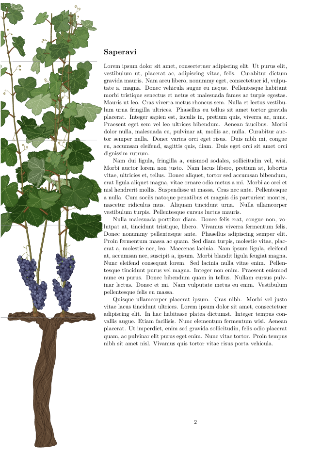
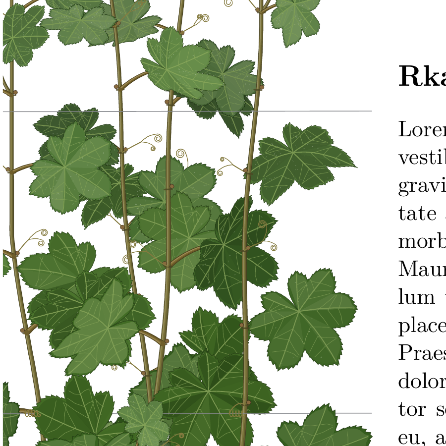

# florilegium, with grapevines

A grapevine that grows in the margin of a page. This is Jack Bracewell's fork of Kevin Raymond's
[florilegium](https://github.com/kevinraymond/florilegium), the LuaLaTeX package that grows
Delft-blue flowers in the margin of a page. The fork keeps only one plant, and draws it properly:
a spur-pruned grapevine trained up the margin as a vineyard trains it, in six varieties, through
the seasons. None of it is an image file. Every cane, leaf, tendril and grape is a curve computed
while the page is made, so every page grows a vine of its own.


*Six varieties at harvest, each the margin of a page of `showcase.tex`.*

[The vine](#the-vine) · [the bunches](#the-bunches) · [the leaves](#the-leaves) ·
[the seasons](#the-seasons) · [the varieties](#the-varieties) · [quick start](#quick-start) ·
[Kevin's original repository](https://github.com/kevinraymond/florilegium)

## The vine



The vine is laid out as a vineyard's is, spur-pruned on a vertical shoot positioned trellis, seen
from the side of the row, with the margin as its panel:

- **The trunk** rises from the foot of the page to the fruiting wire, a third of the way up, and
  divides into the **cordon**, two barked, knotted arms laid along the wire.
- **Spurs** sit along the cordon, each a stub of last year's cane cut back to two buds, its
  pruning cut showing, an old dead stub beside some of them.
- **Shoots** grow from the buds, trained straight up between the catch wires, thick at the base,
  their nodes swollen, and hedged level at the top, where some flop over.
- At every node, a **leaf** on a long stalk, alternately left and right, with the dormant bud in
  its axil. Opposite the leaf: nothing at the first two nodes, a **bunch** at the third and
  fourth (now and then the fifth), then a forked, coiling **tendril** at two nodes in every
  three. That is how a real shoot carries them.
- The **fruit zone** just above the cordon is stripped of its leaves, as growers strip it in
  summer, so the bunches hang clear. Tendrils that reach a catch wire coil round it.

The vine grows in the wider side margin, and in a two-sided document it changes sides with the
page and is drawn mirrored.

## The bunches


A bunch is built the way a grape bunch is: a bare stalk from the node, then a main axis with a
spiral of branches off it, longest at the shoulders. Each branch arches down under its weight
and ends in a small cluster of grapes, each grape on its own short stem, hanging under its own
weight. Compact varieties close up into a tight bunch; looser ones show their gaps.

How many grapes a bunch holds, how big they are and how long the bunch is come from vineyard
figures: about 110 grapes of 13 mm on a 13 cm bunch for pinot noir, for example, drawn a little
larger than life, as an illustrator enlarges the fruit.

Each grape carries its **bloom**, the powdery wax on a grape's skin. It is drawn as a powder,
not a film: uneven drifts of it, thicker on some grapes than others, palest at the rim, rubbed
off in places to show the darker skin, with a fine grain on the grapes nearest you. The grapes
ripen one by one through veraison, from green through red to their own colour, and a few stay
small and green.

## The leaves



A leaf is round, cut into three or five lobes as its variety cuts them, with a sinus where the
stalk joins, saw teeth pointing to the lobe tips, five main veins from the stalk and side veins
off them. It is not flat: each blade cups, droops or arches, ripples between its lobes and
twists a little, then is turned and tipped at an angle of its own and lit by how each part
faces the light. A few are turned over to show their paler underside.

The leaves age along the cane. The oldest, low down, are the largest and, late in the season,
duller, browned at the edges and spotted; the young ones near the tips are small and downy,
covered in fine hairs. How hairy depends on the variety: rkatsiteli's leaves are known for their
down, johanniter's are nearly smooth.

## The seasons


*Pinot noir through the year: short shoots and no fruit in spring, green bunches in summer,
the grapes colouring one by one at veraison, and ripe bunches among red leaves on brown canes
in autumn.*

`\florilegiumgrapesage{a}` sets the season of the following pages: 0 spring, 0.5 summer, 1 autumn. The
shoots grow through spring, the grapes turn at veraison, the shoots ripen to brown canes, and in
autumn the leaves of a black grape turn red and those of a white grape yellow. The option `aging`
spreads the year over the document, spring on the first page and autumn on the last.

## The varieties

| variety | leaf | bunch | grapes |
|---|---|---|---|
| Pinot Noir | three to five shallow lobes | dense, cylindrical | small, blue-black under a dusty bloom |
| Saperavi | three lobes, large | fairly dense, an inverted pear | dark blue, heavily bloomed |
| Gewürztraminer | small, nearly whole | small, dense, cone-shaped | small, oval, each a shade from gold to copper-pink |
| Rkatsiteli | five lobes, downy | fairly dense, cone-shaped, sometimes shouldered | large, yellow-green, flecked with rust |
| Regent | three lobes, cut medium-deep | dense, cylindrical or cone-shaped | large, round, blue-black |
| Johanniter | five lobes, nearly smooth | dense, cylindrical | golden, flecked with rust |

The descriptions follow the varieties' published ampelography where it could be found, and the
colours and shapes were checked against photographs of bunches on the vine.

## Quick start

With LuaLaTeX, put `florilegium-grapes.sty`, `florilegium-grapes.lua`, `florilegium-grapes-ink.lua`
and `florilegium-grapes-vine.lua` beside your document (or upload them to an
[Overleaf](https://www.overleaf.com) project set to LuaLaTeX):

```latex
\usepackage[a4paper,left=68mm,right=22mm]{geometry}   % a wide margin for the vine
\usepackage[vine=pinot]{florilegium-grapes}           % or saperavi, gewurztraminer,
                                                      % rkatsiteli, regent, johanniter
...
\florilegiumgrapesage{0.8}                            % optional: late summer
\florilegiumgrapesvine{saperavi}                      % optional: another variety from here on
```

| option or command | what it does |
|---|---|
| `vine=<variety>` | the variety, for the whole document (default `pinot`) |
| `aging` | the vine ages from spring on the first page to autumn on the last (two runs) |
| `\florilegiumgrapesvine{variety}` | the variety from the page this is set on |
| `\florilegiumgrapesage{a}` | the season of the following pages: 0 spring, 0.5 summer, 1 autumn (default: late summer) |
| `\def\florilegiumgrapesseed{7}` | before `\usepackage`: a fixed seed for the document instead of the page-number seed |

## Build

```sh
lualatex showcase.tex       # a page for each variety at harvest, then pinot noir through the year
texlua tools/bytes.lua      # how much a page's drawing takes, and each part's share
```

A page's drawing is written straight into the PDF, so its size is the cost to watch. The grapes
painted behind others are left out when nothing of them would show (see the bunches).

## Origin

Kevin Raymond made florilegium to answer a
[Reddit post](https://www.reddit.com/r/LaTeX/comments/1xixznw/how_do_you_make_these_flowers_in_latex/)
asking how to make flowers like these in LaTeX: a margin of plants painted in Lua and placed by a
procedural layout, and in 2.0 plants sampled from genomes of botanical traits. Kevin made it with
the assistance of AI (Claude).

Jack Bracewell forked it to grow grapevines. The vine began as one more species among Kevin's
plants, then became a theme of its own, then the whole package: everything that wasn't the vine
was taken out. The fork was also written with Claude (Claude Code). The pictures are procedural
code throughout, with no generative image models.

## Credits

- [florilegium](https://github.com/kevinraymond/florilegium) is Kevin Raymond's. Its drawing core
  (`florilegium-grapes-ink.lua`) and the page geometry and shipout hook in `florilegium-grapes.lua`
  and `florilegium-grapes.sty` are his, trimmed to what the vine needs.
- The random numbers come from [mulberry32](https://gist.github.com/tommyettinger/46a874533244883189143505d203312c),
  Tommy Ettinger's generator, dedicated to the public domain (CC0).
- The varieties' leaves and bunches follow the ampelography of German and English Wikipedia
  (Pinot noir, Regent, Johanniter, Gewürztraminer, Saperavi) and Georgian descriptions of
  Rkatsiteli; the colours and shapes were checked against photographs on Wikimedia Commons.
- Bunch sizes follow Michigan State University's cluster weights for Pinot noir and Cornell
  Cooperative Extension's Long Island trial for Chardonnay; the bunch's structure follows the
  literature on grapevine inflorescence architecture (the rachis, its spiral of branches and
  the pedicels, as in J. Exp. Bot. 70, 2019).
- The training follows Penn State and University of Georgia extension guidance on
  spur-pruned, vertically shoot-positioned vines.

## License

MIT, see [LICENSE](LICENSE). Copyright (c) 2026 Kevin Raymond, and Copyright (c) 2026 Jack
Bracewell for the grapevine (`florilegium-grapes-vine.lua`).
